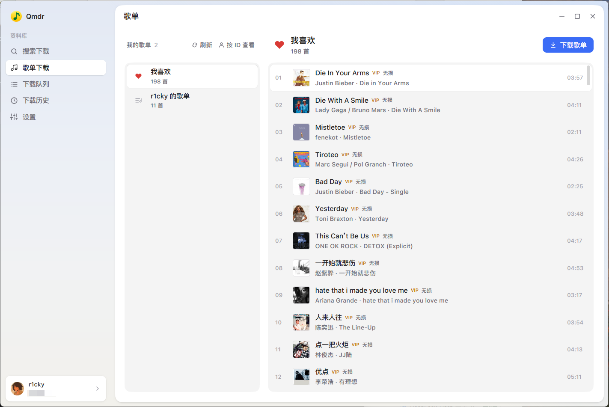

# Qmdr

Qmdr 是一个使用 Go + MyGo 原生 UI 的 QQ 音乐桌面下载工具，目标平台为 Windows、macOS 和 Linux。

## 界面



## 当前进度

- 原生亮色 UI：搜索下载、歌单预览、下载队列、设置
- 搜索结果、歌单歌曲和队列显示专辑封面
- 真实 QQ / 微信扫码登录，凭证保存到配置目录
- 真实搜索、歌单分页读取与批量下载
- 真实文件下载：并发队列、进度、取消、跳过已存在文件、任务日志
- 下载设置持久化，支持 1–8 个并发任务
- 下载完成后写入标题、歌手、专辑、封面和歌词（FLAC / MP3）

## 运行

需要 Go 1.27.1 或更高版本。

```powershell
go run .
# 或构建不带控制台窗口的 Windows 程序
go build -ldflags "-H=windowsgui" -o build/qmdr.exe .
```

## 凭证

Go 客户端从系统配置目录读取 `qqmusic_cred.json`：

- Windows：`%AppData%\Qmdr\qqmusic_cred.json`
- macOS：`~/Library/Application Support/Qmdr/qqmusic_cred.json`
- Linux：`$XDG_CONFIG_HOME/Qmdr/qqmusic_cred.json`

该文件包含登录令牌，不会提交到仓库。设置页可以重新加载或导出 JSON。

## 免责声明

本项目仅供学习和研究使用。请尊重版权、支持正版音乐，并遵守 QQ 音乐相关服务条款。禁止将本项目用于商业用途或任何侵权行为。由于使用本项目所产生的任何法律责任与风险，作者不承担任何责任。
